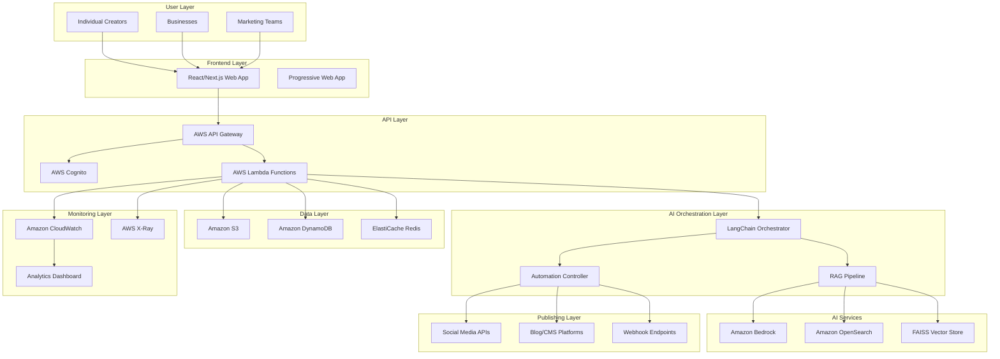
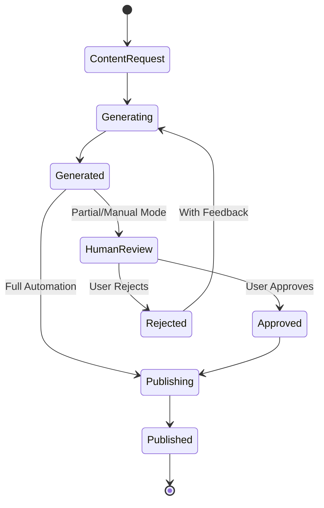

# Design Document: Nexora AI Platform

## Overview

Nexora AI is an enterprise-grade, AWS-native content automation platform that leverages Generative AI to streamline content creation, review, and publishing workflows. The platform is architected as a serverless, multi-tenant system that scales from individual creators to enterprise teams while maintaining responsible AI practices and human oversight controls.

The platform implements a sophisticated RAG (Retrieval-Augmented Generation) pipeline using Amazon Bedrock for AI generation, Amazon OpenSearch for vector storage, and LangChain for orchestration. The architecture follows AWS Well-Architected Framework principles, emphasizing security, reliability, performance efficiency, cost optimization, and operational excellence.

Key architectural decisions include:
- **Serverless-first approach** using AWS Lambda and API Gateway for automatic scaling and cost optimization
- **Event-driven architecture** with asynchronous processing for content generation and publishing workflows  
- **Multi-tenant design** with isolated workspaces and resource quotas
- **Human-in-the-loop controls** with configurable automation levels
- **Responsible AI framework** with content filtering and bias mitigation

## Architecture

### High-Level Architecture



### Microservices Architecture

The platform is decomposed into focused microservices, each implemented as AWS Lambda functions:

**Authentication Service**
- User registration and login via AWS Cognito
- JWT token management and validation
- Role-based access control (RBAC)

**Content Generation Service**
- LangChain orchestration for AI workflows
- RAG pipeline management
- Content quality validation

**Automation Service**
- Workflow execution (full/partial/manual modes)
- Human review gate management
- Scheduling and publishing coordination

**Publishing Service**
- Multi-platform content distribution
- API integration management
- Retry and error handling

**Analytics Service**
- Usage metrics collection
- Performance monitoring
- Business intelligence reporting

**Tenant Management Service**
- Multi-tenant workspace isolation
- Resource quota enforcement
- Billing and subscription management

## Components and Interfaces

### Core Components

#### 1. LangChain Orchestrator

The central AI orchestration component that manages the flow between user inputs, vector retrieval, and AI generation.

**Key Responsibilities:**
- Prompt engineering and template management
- Chain composition for complex workflows
- Memory management for conversational contexts
- Error handling and fallback strategies

**Interface:**
```python
class LangChainOrchestrator:
    def process_content_request(self, request: ContentRequest) -> ContentResponse
    def retrieve_context(self, query: str, tenant_id: str) -> List[Document]
    def generate_content(self, prompt: str, context: List[Document]) -> GeneratedContent
    def validate_output(self, content: GeneratedContent) -> ValidationResult
```

#### 2. RAG Pipeline

Implements retrieval-augmented generation using Amazon OpenSearch as the primary vector database with FAISS as an optional fallback.

**Architecture Flow:**
1. **Document Ingestion**: User uploads → Text extraction → Chunking → Embedding generation → Vector storage
2. **Query Processing**: User query → Query embedding → Similarity search → Context retrieval
3. **Generation**: Retrieved context + User prompt → Amazon Bedrock → Generated content
4. **Post-processing**: Content validation → Formatting → Response delivery

**Vector Storage Strategy:**
- **Primary**: Amazon OpenSearch Serverless for production workloads
- **Secondary**: FAISS for development and cost-sensitive scenarios
- **Hybrid Search**: Combines dense vectors (semantic) with sparse vectors (keyword) for enhanced retrieval

**Interface:**
```python
class RAGPipeline:
    def ingest_documents(self, documents: List[Document], tenant_id: str) -> IngestionResult
    def retrieve_context(self, query: str, tenant_id: str, k: int = 5) -> List[Document]
    def generate_with_context(self, query: str, context: List[Document]) -> GeneratedContent
    def update_embeddings(self, document_id: str, content: str) -> UpdateResult
```

#### 3. Automation Controller

Manages the three automation modes and human-in-the-loop controls.

**Automation Modes:**
- **Full Automation**: Content generation → Auto-publish (no human review)
- **Partial Automation**: Content generation → Human review → Auto-publish
- **Manual Mode**: Content generation → Human review → Manual publish

**State Machine:**


**Interface:**
```python
class AutomationController:
    def execute_workflow(self, request: ContentRequest, mode: AutomationMode) -> WorkflowResult
    def submit_for_review(self, content: GeneratedContent) -> ReviewRequest
    def process_review_decision(self, review_id: str, decision: ReviewDecision) -> WorkflowResult
    def schedule_publication(self, content: ApprovedContent, schedule: PublishSchedule) -> ScheduleResult
```

#### 4. Multi-Tenant Manager

Provides workspace isolation and resource management across different user types and organizations.

**Tenant Isolation:**
- **Data Isolation**: Separate vector indices per tenant in OpenSearch
- **Compute Isolation**: Lambda function isolation with tenant-specific configurations
- **Storage Isolation**: S3 bucket prefixes and DynamoDB partition keys by tenant

**Resource Quotas:**
- API rate limits per tenant tier
- Storage limits for documents and generated content
- AI generation quotas (tokens/requests per month)
- Publishing endpoint limits

**Interface:**
```python
class MultiTenantManager:
    def create_tenant(self, tenant_config: TenantConfig) -> Tenant
    def get_tenant_quotas(self, tenant_id: str) -> ResourceQuotas
    def enforce_rate_limits(self, tenant_id: str, operation: str) -> RateLimitResult
    def isolate_data_access(self, tenant_id: str, resource_type: str) -> AccessPolicy
```

### External Integrations

#### Publishing Endpoints

**Social Media APIs:**
- Twitter/X API v2 for tweet publishing
- LinkedIn API for professional content
- Facebook Graph API for page posts
- Instagram Basic Display API for visual content

**Blog/CMS Platforms:**
- WordPress REST API
- Medium API
- Ghost Admin API
- Custom webhook endpoints

**Integration Pattern:**
```python
class PublishingService:
    def register_endpoint(self, tenant_id: str, endpoint_config: EndpointConfig) -> EndpointId
    def publish_content(self, content: ApprovedContent, endpoints: List[EndpointId]) -> PublishResult
    def handle_webhook(self, endpoint_id: str, payload: dict) -> WebhookResult
    def retry_failed_publications(self, publication_id: str) -> RetryResult
```

## Data Models

### Core Entities

#### User and Tenant Models

```python
@dataclass
class User:
    user_id: str
    email: str
    cognito_sub: str
    tenant_id: str
    role: UserRole  # CREATOR, ADMIN, MEMBER
    created_at: datetime
    last_login: datetime
    preferences: UserPreferences

@dataclass
class Tenant:
    tenant_id: str
    name: str
    type: TenantType  # INDIVIDUAL, BUSINESS, ENTERPRISE
    subscription_tier: SubscriptionTier
    resource_quotas: ResourceQuotas
    created_at: datetime
    settings: TenantSettings
```

#### Content Models

```python
@dataclass
class ContentRequest:
    request_id: str
    tenant_id: str
    user_id: str
    content_type: ContentType  # BLOG_POST, SOCIAL_MEDIA, EMAIL, etc.
    prompt: str
    context_documents: List[str]  # Document IDs for RAG
    automation_mode: AutomationMode
    target_endpoints: List[str]
    schedule: Optional[PublishSchedule]
    created_at: datetime

@dataclass
class GeneratedContent:
    content_id: str
    request_id: str
    title: str
    body: str
    metadata: ContentMetadata
    confidence_score: float
    source_documents: List[str]
    generated_at: datetime
    status: ContentStatus  # GENERATED, UNDER_REVIEW, APPROVED, PUBLISHED

@dataclass
class Document:
    document_id: str
    tenant_id: str
    title: str
    content: str
    embedding: List[float]
    metadata: DocumentMetadata
    uploaded_at: datetime
    last_updated: datetime
```

#### Workflow Models

```python
@dataclass
class WorkflowExecution:
    execution_id: str
    request_id: str
    tenant_id: str
    current_state: WorkflowState
    automation_mode: AutomationMode
    steps_completed: List[WorkflowStep]
    created_at: datetime
    updated_at: datetime

@dataclass
class ReviewRequest:
    review_id: str
    content_id: str
    reviewer_id: str
    status: ReviewStatus  # PENDING, APPROVED, REJECTED
    feedback: Optional[str]
    created_at: datetime
    reviewed_at: Optional[datetime]

@dataclass
class PublicationRecord:
    publication_id: str
    content_id: str
    endpoint_id: str
    status: PublicationStatus  # SCHEDULED, PUBLISHING, PUBLISHED, FAILED
    published_at: Optional[datetime]
    external_id: Optional[str]  # ID from external platform
    error_message: Optional[str]
```

### Database Schema Design

#### DynamoDB Tables

**Users Table**
- Partition Key: `user_id`
- GSI: `tenant_id` for tenant-based queries
- Attributes: User profile and preferences

**Tenants Table**
- Partition Key: `tenant_id`
- Attributes: Tenant configuration and quotas

**Content Requests Table**
- Partition Key: `tenant_id`
- Sort Key: `request_id`
- GSI: `user_id` for user-specific queries
- TTL: Configurable retention period

**Generated Content Table**
- Partition Key: `tenant_id`
- Sort Key: `content_id`
- GSI: `request_id` for request-based queries
- Attributes: Content data and metadata

**Workflow Executions Table**
- Partition Key: `tenant_id`
- Sort Key: `execution_id`
- GSI: `request_id` for request tracking
- Attributes: Workflow state and history

#### Amazon S3 Structure

```
nexora-content-bucket/
├── tenants/
│   └── {tenant_id}/
│       ├── documents/
│       │   └── {document_id}/
│       │       ├── original.{ext}
│       │       ├── processed.txt
│       │       └── metadata.json
│       ├── generated/
│       │   └── {content_id}/
│       │       ├── content.json
│       │       └── assets/
│       └── exports/
│           └── {export_id}/
└── system/
    ├── templates/
    └── models/
```

#### Amazon OpenSearch Index Structure

**Documents Index**
```json
{
  "mappings": {
    "properties": {
      "tenant_id": {"type": "keyword"},
      "document_id": {"type": "keyword"},
      "title": {"type": "text"},
      "content": {"type": "text"},
      "embedding": {
        "type": "knn_vector",
        "dimension": 1536,
        "method": {
          "name": "hnsw",
          "space_type": "cosinesimil"
        }
      },
      "metadata": {"type": "object"},
      "created_at": {"type": "date"}
    }
  }
}
```

**Content Index**
```json
{
  "mappings": {
    "properties": {
      "tenant_id": {"type": "keyword"},
      "content_id": {"type": "keyword"},
      "content_type": {"type": "keyword"},
      "title": {"type": "text"},
      "body": {"type": "text"},
      "embedding": {
        "type": "knn_vector",
        "dimension": 1536,
        "method": {
          "name": "hnsw",
          "space_type": "cosinesimil"
        }
      },
      "tags": {"type": "keyword"},
      "created_at": {"type": "date"}
    }
  }
}
```

## Correctness Properties

*A property is a characteristic or behavior that should hold true across all valid executions of a system—essentially, a formal statement about what the system should do. Properties serve as the bridge between human-readable specifications and machine-verifiable correctness guarantees.*

### Property 1: Authentication Token Generation
*For any* successful user authentication with valid credentials, the system should generate secure session tokens with appropriate expiration times and proper JWT structure.
**Validates: Requirements 1.2**

### Property 2: Session Expiration Redirect
*For any* expired user session, accessing protected resources should redirect to login while preserving the intended destination URL.
**Validates: Requirements 1.3**

### Property 3: Role-Based Access Control
*For any* user with a specific role, access to resources should be granted or denied based on the role's permissions, ensuring proper authorization boundaries.
**Validates: Requirements 1.4**

### Property 4: Authentication Error Handling
*For any* authentication failure with invalid credentials, the system should return clear error messages without exposing sensitive security information.
**Validates: Requirements 1.5**

### Property 5: Content Generation Pipeline
*For any* valid content request, the system should process it through the RAG pipeline, retrieve relevant context, generate content using Amazon Bedrock, and return structured output with metadata and confidence scores.
**Validates: Requirements 2.1, 2.2, 2.4**

### Property 6: Content Type Support
*For any* supported content type (blog post, social media, marketing copy), the system should successfully process generation requests and produce appropriate output format.
**Validates: Requirements 2.3**

### Property 7: Rate Limiting Enforcement
*For any* user or tenant exceeding configured rate limits, the system should reject additional requests and provide appropriate rate limit error responses.
**Validates: Requirements 2.5**

### Property 8: Generation Error Handling
*For any* content generation failure, the system should provide meaningful error messages and offer fallback options without crashing the workflow.
**Validates: Requirements 2.6**

### Property 9: Automation Mode Support
*For any* workflow execution, the system should correctly implement the specified automation mode (full, partial, or manual) and enforce appropriate human review gates.
**Validates: Requirements 3.1, 3.2**

### Property 10: Human Review Workflow
*For any* human review decision (approve or reject), the system should correctly progress the workflow to the next step or return to generation with feedback.
**Validates: Requirements 3.3, 3.4**

### Property 11: Content Editing Capability
*For any* content under human review, the system should allow modifications and preserve changes through the approval process.
**Validates: Requirements 3.5**

### Property 12: Audit Logging
*For any* human decision or content modification, the system should create comprehensive audit logs with timestamps, user information, and action details.
**Validates: Requirements 3.6**

### Property 13: Content Scheduling
*For any* approved content, the system should allow scheduling with future publication dates and times, storing the schedule correctly.
**Validates: Requirements 4.1**

### Property 14: Multi-Platform Publishing
*For any* configured publishing endpoint (social media, blog, CMS), the system should successfully integrate and publish content to the platform.
**Validates: Requirements 4.2**

### Property 15: Scheduled Publication Execution
*For any* scheduled content when the scheduled time arrives, the system should automatically distribute content to configured endpoints and update status accordingly.
**Validates: Requirements 4.3, 4.5**

### Property 16: Publishing Error Handling
*For any* API failure during publishing, the system should implement retry mechanisms, provide error notifications, and maintain publication status tracking.
**Validates: Requirements 4.4**

### Property 17: Webhook Notifications
*For any* configured webhook endpoint, the system should send appropriate notifications for relevant events (publication success, failure, etc.).
**Validates: Requirements 4.6**

### Property 18: RAG Document Ingestion
*For any* user-provided document, the system should successfully ingest it into the vector store, generate embeddings, and make it available for retrieval.
**Validates: Requirements 5.1**

### Property 19: RAG Context Retrieval and Processing
*For any* content request, the RAG pipeline should retrieve semantically relevant context, combine it with user prompts, and provide source attribution in the generated content.
**Validates: Requirements 5.2, 5.4, 5.6**

### Property 20: Vector Store Backend Support
*For any* configured vector store backend (OpenSearch or FAISS), the system should successfully store and retrieve embeddings with consistent behavior.
**Validates: Requirements 5.3**

### Property 21: RAG Graceful Degradation
*For any* context retrieval failure, the system should gracefully degrade to prompt-only generation without failing the entire request.
**Validates: Requirements 5.5**

### Property 22: Analytics Metrics Tracking
*For any* content generation, publishing activity, or user engagement event, the system should track appropriate metrics and make them available for reporting.
**Validates: Requirements 7.1, 7.2, 7.3**

### Property 23: Analytics Dashboard Access
*For any* user role (individual, team member, administrator), the system should provide appropriate dashboard views with role-specific data visibility.
**Validates: Requirements 7.4**

### Property 24: Automated Report Generation
*For any* configured reporting schedule, the system should generate reports with accurate content performance and system usage data.
**Validates: Requirements 7.5**

### Property 25: Content Filtering
*For any* potentially harmful or inappropriate content generation attempt, the responsible AI framework should filter the content and prevent harmful output.
**Validates: Requirements 8.1**

### Property 26: Bias Detection and Mitigation
*For any* content generation that might contain bias, the system should apply mitigation mechanisms and flag content for review when necessary.
**Validates: Requirements 8.2, 8.3**

### Property 27: AI Decision Transparency
*For any* AI-driven decision or content generation, the system should maintain transparency logs with decision rationale and influencing factors.
**Validates: Requirements 8.4**

### Property 28: Content Sensitivity Controls
*For any* user-configured sensitivity level, the system should apply appropriate content filtering and generation parameters.
**Validates: Requirements 8.5**

### Property 29: Multi-Tenant Workspace Isolation
*For any* tenant, the system should provide isolated workspaces where data and resources cannot be accessed by other tenants.
**Validates: Requirements 9.1, 9.4**

### Property 30: Resource Quota Enforcement
*For any* tenant based on their subscription tier, the system should enforce appropriate resource quotas and usage limits.
**Validates: Requirements 9.2**

### Property 31: Quota Exceeded Notifications
*For any* user exceeding their resource quotas, the system should provide clear notifications and present upgrade options.
**Validates: Requirements 9.3**

### Property 32: Team Collaboration Features
*For any* team within an organization, the system should provide collaboration features while maintaining organizational boundaries.
**Validates: Requirements 9.5**

### Property 33: Administrative Controls
*For any* team manager or organization owner, the system should provide appropriate administrative controls for their scope of authority.
**Validates: Requirements 9.6**

### Property 34: Real-Time Status Updates
*For any* active workflow (content generation, publishing), the frontend should provide real-time status updates to users.
**Validates: Requirements 10.2**

### Property 35: User Interface Feedback
*For any* user interaction with the interface, the system should provide immediate feedback and appropriate loading states.
**Validates: Requirements 10.3**

### Property 36: File Upload Processing
*For any* file uploaded via drag-and-drop for RAG ingestion, the system should successfully process and ingest the file into the vector store.
**Validates: Requirements 10.4**

## Error Handling

### Error Classification and Response Strategy

The platform implements a comprehensive error handling strategy that categorizes errors by severity and provides appropriate responses:

#### Critical Errors (System Failures)
- **Database connectivity issues**: Automatic retry with exponential backoff, fallback to cached data
- **AI service unavailability**: Graceful degradation to cached responses or alternative models
- **Authentication service failures**: Temporary access tokens, offline mode for critical operations

#### Business Logic Errors (User-Correctable)
- **Invalid content requests**: Clear validation messages with correction suggestions
- **Quota exceeded**: Informative messages with upgrade paths and usage analytics
- **Publishing failures**: Retry mechanisms with user notification and manual retry options

#### Integration Errors (External Dependencies)
- **Social media API failures**: Queue for retry, alternative publishing channels
- **Webhook delivery failures**: Exponential backoff retry, dead letter queue for manual intervention
- **Vector store timeouts**: Fallback to alternative storage, cached embeddings

### Error Response Format

All API errors follow a consistent JSON structure:

```json
{
  "error": {
    "code": "CONTENT_GENERATION_FAILED",
    "message": "Content generation failed due to insufficient context",
    "details": {
      "request_id": "req_123456",
      "timestamp": "2024-01-15T10:30:00Z",
      "retry_after": 300,
      "suggested_actions": [
        "Add more context documents",
        "Simplify the content request",
        "Try again in 5 minutes"
      ]
    },
    "correlation_id": "corr_789012"
  }
}
```

### Circuit Breaker Pattern

Critical external dependencies implement circuit breaker patterns:

- **Amazon Bedrock**: 5 failures in 60 seconds triggers 30-second circuit break
- **Publishing APIs**: 3 consecutive failures triggers 5-minute circuit break
- **Vector Store**: 10 failures in 120 seconds triggers 60-second circuit break

## Testing Strategy

### Dual Testing Approach

The platform employs both unit testing and property-based testing for comprehensive coverage:

**Unit Tests**:
- Specific examples and edge cases for individual components
- Integration points between microservices
- Error conditions and boundary cases
- Mock external dependencies for isolated testing

**Property-Based Tests**:
- Universal properties that hold across all inputs
- Comprehensive input coverage through randomization
- Validation of business rules and invariants
- End-to-end workflow correctness

### Property-Based Testing Configuration

**Framework**: Hypothesis (Python) for property-based testing
**Minimum Iterations**: 100 per property test
**Test Tagging**: Each property test references its design document property

Example property test structure:
```python
@given(content_request=content_request_strategy())
@settings(max_examples=100)
def test_content_generation_pipeline(content_request):
    """
    Feature: nexora-ai-platform, Property 5: Content Generation Pipeline
    For any valid content request, the system should process it through 
    the RAG pipeline and return structured output with metadata.
    """
    result = content_service.generate_content(content_request)
    
    assert result.status == "success"
    assert result.content is not None
    assert result.metadata.confidence_score >= 0.0
    assert result.metadata.confidence_score <= 1.0
    assert len(result.source_documents) > 0
```

### Testing Environments

**Development**: Local testing with mocked AWS services using LocalStack
**Staging**: Full AWS environment with test data and reduced quotas
**Production**: Canary deployments with gradual traffic shifting

### Performance Testing

**Load Testing**: Simulate concurrent users across different tenant types
**Stress Testing**: Validate system behavior under extreme load conditions
**Endurance Testing**: Long-running tests to identify memory leaks and resource exhaustion

### Security Testing

**Authentication Testing**: Verify JWT token security and session management
**Authorization Testing**: Validate role-based access controls across all endpoints
**Data Isolation Testing**: Ensure multi-tenant data separation
**Input Validation Testing**: Prevent injection attacks and malformed data processing

### Monitoring and Observability

**Metrics Collection**: Custom CloudWatch metrics for business and technical KPIs
**Distributed Tracing**: AWS X-Ray for request flow visualization
**Log Aggregation**: Centralized logging with structured JSON format
**Alerting**: Proactive alerts for error rates, latency, and business metrics

The testing strategy ensures that the platform maintains high reliability, security, and performance standards while supporting rapid development and deployment cycles.